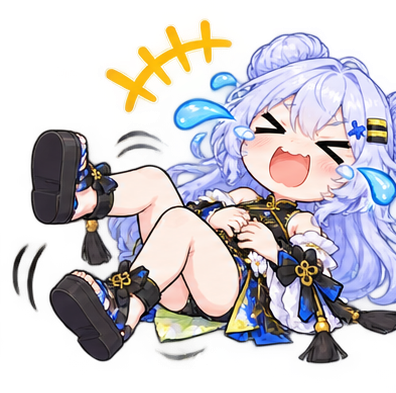
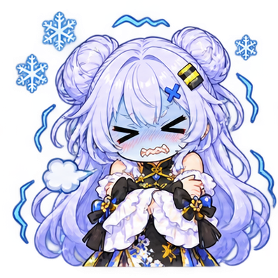
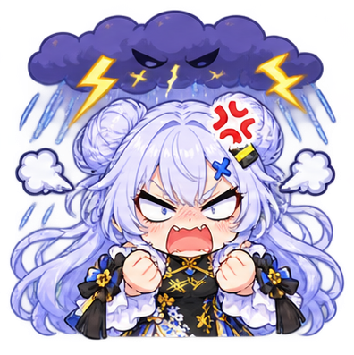
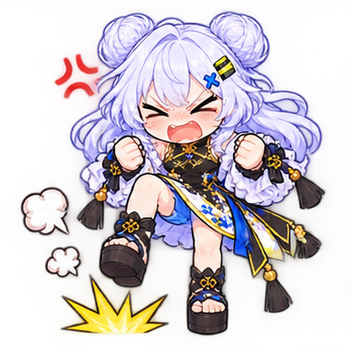
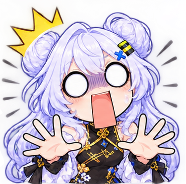
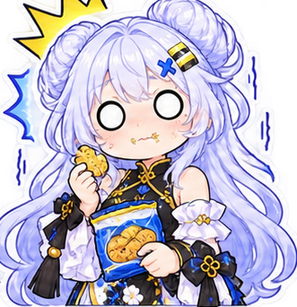

# Molly Meme · 茉莉表情包

一些可爱又实用的 Q 版茉莉表情，适合聊天、Issue 回复和文档配图。

共 39 张，分两批存放在 [`images/`](images/) 和 [`reaction_stickers_part_01/`](reaction_stickers_part_01/) 目录。

## 表情一览

| 预览 | 文件 | 表情 |
| :---: | --- | --- |
|  | [`01-thumbs-up.jpg`](images/01-thumbs-up.jpg) | 点赞 / 干得漂亮 |
|  | [`02-speechless.jpg`](images/02-speechless.jpg) | 无语 / 沉默 |
|  | [`03-shocked-question.jpg`](images/03-shocked-question.jpg) | 震惊 / 问号 |
|  | [`04-grin.jpg`](images/04-grin.jpg) | 大笑 / 开心 |
|  | [`05-crying.jpg`](images/05-crying.jpg) | 大哭 / 委屈 |
|  | [`06-furious.jpg`](images/06-furious.jpg) | 发火 / 生气 |
|  | [`07-love-you.jpg`](images/07-love-you.jpg) | 比心 / 茉莉也爱你哦 |
|  | [`08-pointing.jpg`](images/08-pointing.jpg) | 指责 / 用不了就别用 |
|  | [`09-ok.jpg`](images/09-ok.jpg) | OK / 没问题 |
|  | [`10-smug-troll.jpg`](images/10-smug-troll.jpg) | 得意 / 搞事搞事 |
|  | [`11-brain-overload.jpg`](images/11-brain-overload.jpg) | 脑过载 / 宕机 |

## 第二批：reaction_stickers_part_01

28 张透明背景 PNG，文件名沿用原目录，未作重命名。

<table>
  <tr>
    <td align="center"><a href="reaction_stickers_part_01/sticker_001.png"></a><br><sub><code>sticker_001.png</code></sub></td>
    <td align="center"><a href="reaction_stickers_part_01/sticker_002.png"></a><br><sub><code>sticker_002.png</code></sub></td>
    <td align="center"><a href="reaction_stickers_part_01/sticker_003.png"></a><br><sub><code>sticker_003.png</code></sub></td>
    <td align="center"><a href="reaction_stickers_part_01/sticker_004.png"></a><br><sub><code>sticker_004.png</code></sub></td>
  </tr>
  <tr>
    <td align="center"><a href="reaction_stickers_part_01/sticker_005.png"></a><br><sub><code>sticker_005.png</code></sub></td>
    <td align="center"><a href="reaction_stickers_part_01/sticker_006.png"></a><br><sub><code>sticker_006.png</code></sub></td>
    <td align="center"><a href="reaction_stickers_part_01/sticker_007.png"></a><br><sub><code>sticker_007.png</code></sub></td>
    <td align="center"><a href="reaction_stickers_part_01/sticker_008.png"></a><br><sub><code>sticker_008.png</code></sub></td>
  </tr>
  <tr>
    <td align="center"><a href="reaction_stickers_part_01/sticker_010.png"></a><br><sub><code>sticker_010.png</code></sub></td>
    <td align="center"><a href="reaction_stickers_part_01/sticker_011.png"></a><br><sub><code>sticker_011.png</code></sub></td>
    <td align="center"><a href="reaction_stickers_part_01/sticker_012.png"></a><br><sub><code>sticker_012.png</code></sub></td>
    <td align="center"><a href="reaction_stickers_part_01/sticker_014.png"></a><br><sub><code>sticker_014.png</code></sub></td>
  </tr>
  <tr>
    <td align="center"><a href="reaction_stickers_part_01/sticker_015.png"></a><br><sub><code>sticker_015.png</code></sub></td>
    <td align="center"><a href="reaction_stickers_part_01/sticker_016.png"></a><br><sub><code>sticker_016.png</code></sub></td>
    <td align="center"><a href="reaction_stickers_part_01/sticker_017.png"></a><br><sub><code>sticker_017.png</code></sub></td>
    <td align="center"><a href="reaction_stickers_part_01/sticker_019.png"></a><br><sub><code>sticker_019.png</code></sub></td>
  </tr>
  <tr>
    <td align="center"><a href="reaction_stickers_part_01/sticker_020.png"></a><br><sub><code>sticker_020.png</code></sub></td>
    <td align="center"><a href="reaction_stickers_part_01/sticker_021.png"></a><br><sub><code>sticker_021.png</code></sub></td>
    <td align="center"><a href="reaction_stickers_part_01/sticker_032.png"></a><br><sub><code>sticker_032.png</code></sub></td>
    <td align="center"><a href="reaction_stickers_part_01/sticker_033.png"></a><br><sub><code>sticker_033.png</code></sub></td>
  </tr>
  <tr>
    <td align="center"><a href="reaction_stickers_part_01/sticker_036.png"></a><br><sub><code>sticker_036.png</code></sub></td>
    <td align="center"><a href="reaction_stickers_part_01/sticker_038.png"></a><br><sub><code>sticker_038.png</code></sub></td>
    <td align="center"><a href="reaction_stickers_part_01/sticker_039.png"></a><br><sub><code>sticker_039.png</code></sub></td>
    <td align="center"><a href="reaction_stickers_part_01/sticker_040.png"></a><br><sub><code>sticker_040.png</code></sub></td>
  </tr>
  <tr>
    <td align="center"><a href="reaction_stickers_part_01/sticker_041.png"></a><br><sub><code>sticker_041.png</code></sub></td>
    <td align="center"><a href="reaction_stickers_part_01/sticker_042.png"></a><br><sub><code>sticker_042.png</code></sub></td>
    <td align="center"><a href="reaction_stickers_part_01/sticker_066.png"></a><br><sub><code>sticker_066.png</code></sub></td>
    <td align="center"><a href="reaction_stickers_part_01/sticker_069.png"></a><br><sub><code>sticker_069.png</code></sub></td>
  </tr>
</table>

## 使用方式

在 Markdown 或网页中直接引用：

```markdown

```

也可以把 `images/` 和 `reaction_stickers_part_01/` 里的文件直接下载到本地使用。

## 说明

表情包仅供交流使用，角色及相关素材版权归原作者所有。
